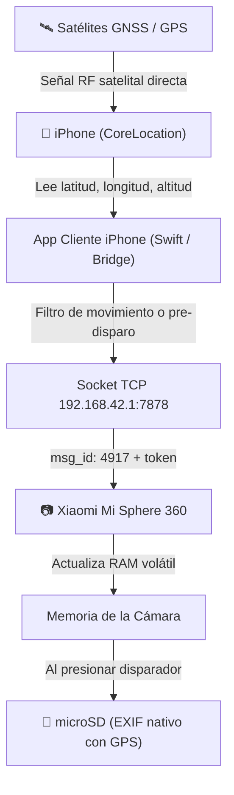

# Plan de Implementación: Inyección GPS en Tiempo Real (Camino A)
**Dispositivo objetivo:** iPhone + Xiaomi Mi Sphere 360 (Ambarella A12 / S2L)  
**Protocolo:** TCP Socket (puerto 7878) — `MSG_SET_GPS` (`msg_id: 4917`)  
**Fecha de guardado:** 6 de noviembre de 2026  

---

## 1. Objetivo
Permitir que las fotos capturadas con la Xiaomi Mi Sphere 360 se guarden en la tarjeta microSD ya geolocalizadas de forma nativa en sus metadatos EXIF (`GPSLatitude`, `GPSLongitude`, `GPSAltitude`, `GPSTimeStamp`), aprovechando el chip de hardware GPS del iPhone mientras ambos dispositivos están conectados por Wi-Fi.

---

## 2. Arquitectura de la Solución



---

## 3. Componentes Clave

### A. Obtención de GPS en el iPhone
* **Framework:** `CoreLocation` con precisión `kCLLocationAccuracyBest`.
* **Modo de conexión:** No requiere internet ni red celular. Funciona con el receptor satelital del teléfono aun estando asociado a la red Wi-Fi sin salida a internet de la cámara (`MJXJ-010135`).
* **Frecuencia de lectura:**
  * Modo pasivo: se actualiza cada vez que el desplazamiento supera los 5 metros.
  * Modo pre-disparo: lectura forzada inmediata en cuanto el usuario presiona el botón de captura en la interfaz.

### B. Comunicación con la Cámara (`MSG_SET_GPS = 4917`)
* **Destino:** `192.168.42.1:7878` (TCP).
* **Estructura del paquete JSON:**
  ```json
  {
    "token": "<session_token>",
    "msg_id": 4917,
    "param": "<latitud>,<longitud>,<altitud>"
  }
  ```
* **Respuesta esperada:**
  ```json
  {
    "rval": 0,
    "msg_id": 4917
  }
  ```
* **Control de temperatura:** Limitar los envíos periódicos a intervalos de no menos de 5 a 10 segundos para evitar saturación de la antena Wi-Fi y sobrecalentamiento del procesador de la cámara.

### C. Cliente en iPhone
* **Opción Nativa (Recomendada):** App en Swift / SwiftUI con `Network.framework` (`NWConnection`) para sockets TCP directos y `CoreLocation`.
* **Opción Web Envoltorio:** PWA o WebKit local con un micro-servicio puente en el teléfono que traduzca peticiones HTTP/WebSocket a TCP crudo.

---

## 4. Estado de las Fotos Resultantes
* Las fotos resultantes (`.JPG`) salen de la cámara con los metadatos EXIF completos:
  * `GPSLatitude` / `GPSLatitudeRef` (Norte / Sur)
  * `GPSLongitude` / `GPSLongitudeRef` (Este / Oeste)
  * `GPSAltitude` / `GPSAltitudeRef`
  * `GPSTimeStamp` / `GPSDateStamp`
* Al transferir las fotos a la Mac mediante el cosidor [Mi Sphere 360.app](file:///Users/ssombra/Documents/Apps/MiSphere/Mi%20Sphere%20360.app), la versión procesada `_360.JPG` heredará y preservará estos mismos datos GPS junto con la proyección equirrectangular y las etiquetas XMP GPano.

---

## 5. Próximos Pasos al Retomar
1. Probar el comando de prueba `4917` con parámetros simulados sobre la cámara para validar la respuesta `{"rval": 0}` del firmware.
2. Definir el entorno del cliente móvil para iPhone (App nativa en Xcode/Swift vs app web asistida).
